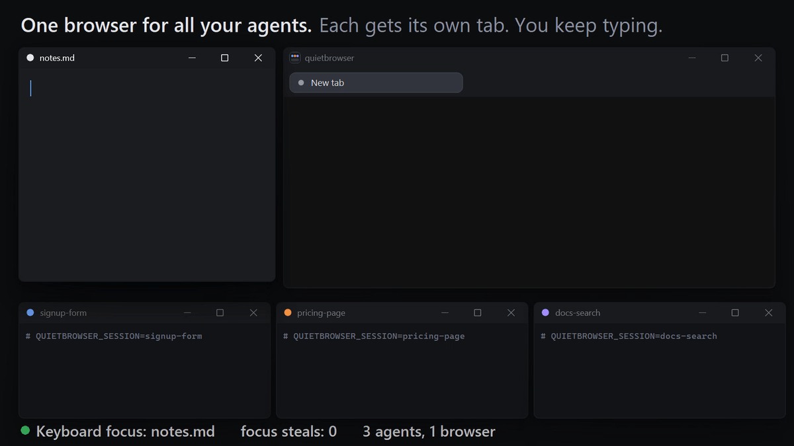

# quietbrowser

**A browser for coding agents that never steals your focus.**



On Windows, a real browser window (Microsoft Edge WebView2) that opens behind whatever you are doing and never takes keyboard focus. On macOS and Linux, your installed Chrome, Edge, Brave or Chromium, run headless so it cannot take focus. Your agent drives it over MCP or from the command line while you keep typing.

## MCP

The tools use the same names and arguments as Playwright MCP (`browser_navigate`, `browser_snapshot`, `browser_click`, `browser_type`, ...).

```
claude mcp add quietbrowser -- npx -y quietbrowser mcp
codex mcp add quietbrowser -- npx -y quietbrowser mcp
```

## CLI

```
npx -y quietbrowser open example.com
npx -y quietbrowser click e3
npx -y quietbrowser install-skill
```

Windows x64, macOS (Intel and Apple Silicon) and Linux x64. The package ships a small binary for each, nothing is downloaded at install time.

Docs, focus measurements and source: https://github.com/emrehangorgec/quietbrowser
